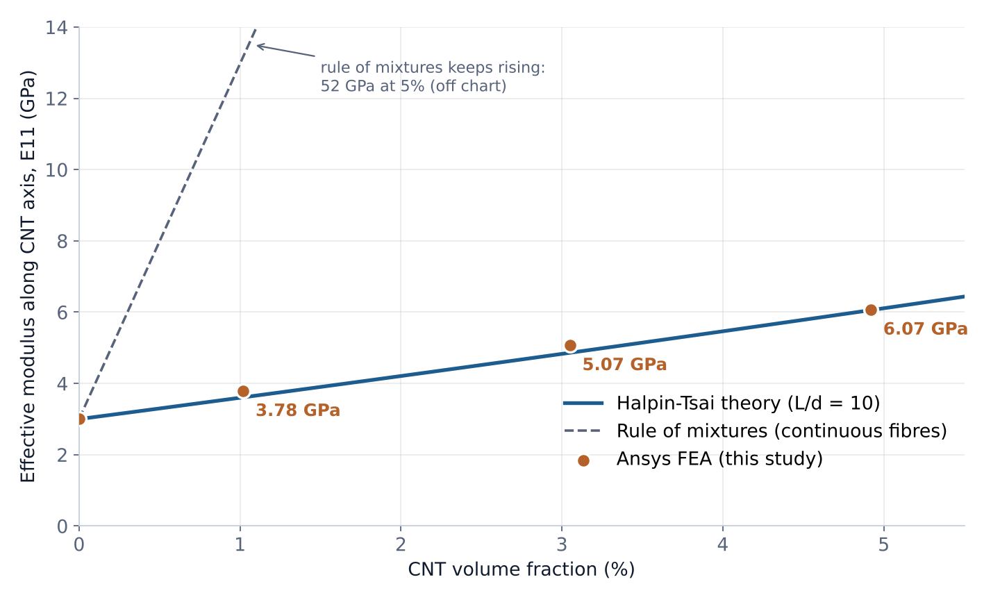
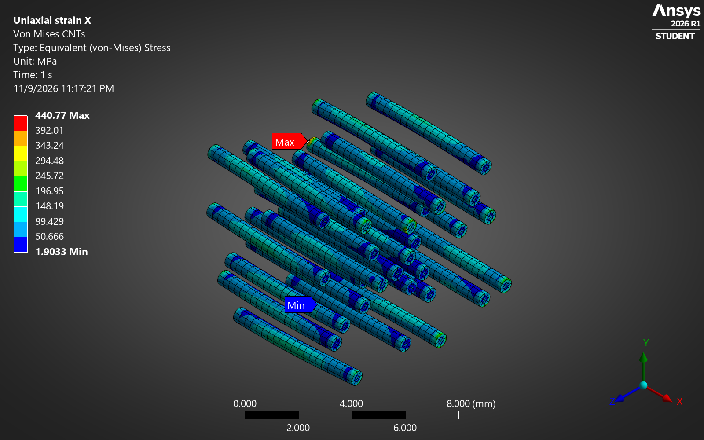
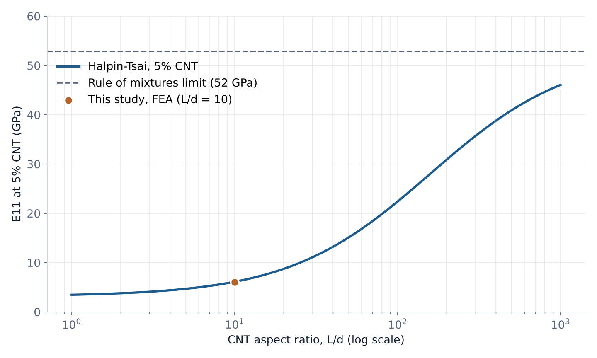

# CNT/epoxy nanocomposite: how much stiffer?

**Engineering tools:** Autodesk Fusion 360 · ANSYS Mechanical 2026 R1

## Models and simulation files

| RVE configuration | CAD geometry | Tube coordinates | FEA results |
| --- | --- | --- | --- |
| Plain epoxy, 0% CNT | [STEP](step/RVE_CNT_0pct.step) | [CSV](step/RVE_CNT_0pct_fibres.csv) | [JSON](results/result_RVE_CNT_0pct.json) |
| 1.02% CNT, 6 tubes | [STEP](step/RVE_CNT_1pct.step) | [CSV](step/RVE_CNT_1pct_fibres.csv) | [JSON](results/result_RVE_CNT_1pct.json) |
| 3.05% CNT, 18 tubes | [STEP](step/RVE_CNT_3pct.step) | [CSV](step/RVE_CNT_3pct_fibres.csv) | [JSON](results/result_RVE_CNT_3pct.json) |
| 4.92% CNT, 29 tubes | [STEP](step/RVE_CNT_5pct.step) | [CSV](step/RVE_CNT_5pct_fibres.csv) | [JSON](results/result_RVE_CNT_5pct.json) |

**Start here:** [Download, opening instructions, and file catalog](docs/CAD_GUIDE.md).

[ANSYS walkthrough](media/ansys_walkthrough.mp4) · [Mesh](media/mesh_5pct.png) · [Stress contour](media/cnt_stress_5pct.png)

The STEP files provide exchange geometry. A native Fusion archive (`.f3d`/`.f3z`) and native ANSYS project are not included in this repository. Supporting scripts document geometry generation and repeated solves; the method below identifies those steps.

Five percent carbon nanotubes doubles the stiffness of epoxy. The rule of mixtures says it should be about nine times higher. This study finds out why, with a representative volume element (RVE) built in Autodesk Fusion and solved in ANSYS Mechanical.



## Results

| CNT volume | Tubes | ANSYS FEA | Halpin-Tsai | Rule of mixtures |
|---|---|---|---|---|
| 0% | 0 | 3.00 GPa | 3.00 GPa | 3.0 GPa |
| 1.02% | 6 | 3.78 GPa | 3.61 GPa | 13.1 GPa |
| 3.05% | 18 | 5.07 GPa | 4.86 GPa | 33.4 GPa |
| 4.92% | 29 | 6.07 GPa | 6.06 GPa | 52.0 GPa |

FEA stays within 5% of Halpin-Tsai at every fraction. The tubes are short (length 10 times the diameter), so they only carry full load near their middle. Load has to pass in from the epoxy by shear, which the stress plot below shows: low at the tube ends, highest mid-length.



Tube length matters more than the amount you add. At the same 5%, Halpin-Tsai gives about 22 GPa for L/d = 100.



## Method

1. **Geometry (Autodesk Fusion).** `fusion/NanocompositeRVE.py` builds a 10 mm epoxy cube with aligned CNTs (solid cylinders, d = 0.6 mm, L = 6 mm) at 0, 1, 3 and 5% by volume. Tubes are placed at random with a minimum gap and no overlaps (seed 7). Each cell is exported as STEP, with tube positions in CSV.
2. **Materials.** Epoxy E = 3 GPa, ν = 0.35. CNT treated as an effective solid, E = 1000 GPa, ν = 0.20.
3. **FEA (ANSYS Mechanical 2026 R1).** Each tube is bonded to its hole in the epoxy (MPC contact, `ansys/bond_cnts.py`). Quadratic tetrahedra, 0.8 mm overall and 0.3 mm on the tubes. Normal displacement fixed on three origin faces, 0.01 mm (0.1% strain) applied along the tube axis on the opposite face. The reaction force gives the effective modulus E11 = F / (A · ε).
4. **Theory.** Halpin-Tsai for aligned short fibres (ζ = 2L/d) and the rule of mixtures for continuous fibres.

`ansys/rve_solve.py` runs the whole case from a script. `media/ansys_walkthrough.mp4` is a screen recording of the same 5% case set up by hand in the ANSYS interface.

## Checks

- Plain epoxy cell returns 3.000 GPa, the input value, with uniform stress.
- Mesh refinement (65k to 97k nodes) moves the 5% result by 0.8%.
- All 29 tubes bonded: every tube face matched to its hole. An early run without bonded contact gave 2.84 GPa, softer than epoxy, which is how the missing contact was caught.
- The hand-built ANSYS model (video) gives 603.8 N reaction force, E = 6.04 GPa, matching the scripted run.

## Limits

Tubes are aligned, straight and perfectly bonded, so these are upper-bound stiffnesses for this geometry. Random orientation, waviness and a weak interface would all lower them. Next steps: randomly oriented tubes and a cohesive interface.

## Files

```
fusion/   Fusion API scripts (RVE generator, material assignment)
ansys/    Mechanical scripts and material data
step/     RVE geometry (STEP), tube positions, theory values
results/  FEA results per case (JSON)
media/    plots, stress images, walkthrough video
```

Sai Phanidhar Ammiraju · [Portfolio](https://saiphani02.github.io/nanocomposite.html) · [LinkedIn](https://www.linkedin.com/in/sai-ammiraju)
