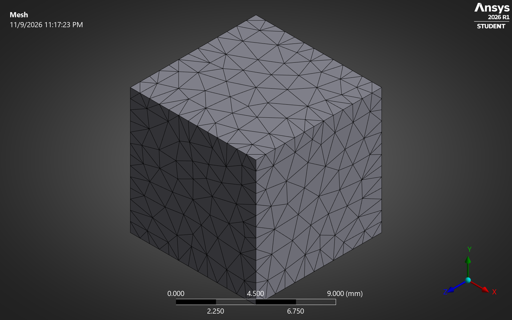

# CNT/epoxy nanocomposite: how much stiffer?

Adding 5% carbon nanotubes doubles the stiffness of epoxy. The rule of mixtures says it should be about nine times stiffer. I built a representative volume element (RVE) in Autodesk Fusion and solved it in ANSYS Mechanical to find out why.

**Tools:** Autodesk Fusion 360 · ANSYS Mechanical 2026 R1

## Results

| CNT volume | Tubes | ANSYS FEA | Halpin-Tsai | Rule of mixtures |
|---|---|---|---|---|
| 0% | 0 | 3.00 GPa | 3.00 GPa | 3.0 GPa |
| 1.02% | 6 | 3.78 GPa | 3.61 GPa | 13.1 GPa |
| 3.05% | 18 | 5.07 GPa | 4.86 GPa | 33.4 GPa |
| 4.92% | 29 | 6.07 GPa | 6.06 GPa | 52.0 GPa |

FEA stays within 5% of Halpin-Tsai at every fraction. The tubes are short (length is 10 times the diameter), so they only carry full load near their middle. Load has to pass in from the epoxy by shear, and the stress plot shows it: low at the tube ends, highest at mid-length.

Tube length matters more than how much you add. At the same 5%, Halpin-Tsai gives about 22 GPa for L/d = 100.

## Model setup

**Geometry (Autodesk Fusion)**

- 10 mm epoxy cube with aligned CNTs modeled as solid cylinders, d = 0.6 mm, L = 6 mm
- Four cells: 0, 1, 3 and 5% CNT by volume
- Tubes placed at random positions with a minimum gap and no overlaps
- Each cell exported as STEP, with tube positions recorded in CSV

**Materials**

| Material | E (GPa) | Poisson's ratio |
|---|---|---|
| Epoxy | 3 | 0.35 |
| CNT (effective solid) | 1000 | 0.20 |

**FEA (ANSYS Mechanical)**

- Each tube bonded to its hole in the epoxy (MPC contact)
- Quadratic tetrahedral mesh: 0.8 mm overall, 0.3 mm on the tubes
- Normal displacement fixed on the three faces at the origin
- 0.01 mm displacement (0.1% strain) applied along the tube axis on the opposite face
- Effective modulus from the reaction force: E11 = F / (A · ε)

**Theory for comparison**

- Halpin-Tsai for aligned short fibres, with ζ = 2L/d
- Rule of mixtures for continuous fibres

## Checks

- The plain epoxy cell returns 3.000 GPa, the input value, with uniform stress.
- Mesh refinement from 65k to 97k nodes moves the 5% result by 0.8%.
- All 29 tubes bonded, with every tube face matched to its hole. An early run without bonded contact gave 2.84 GPa, softer than plain epoxy, which is how I caught the missing contact.
- The 5% case set up again from scratch in the ANSYS interface (see the walkthrough video) gives a 603.8 N reaction force and E = 6.04 GPa, matching the original run.

## Limitations

The tubes are aligned, straight and perfectly bonded, so these are upper-bound stiffnesses for this geometry. Random orientation, waviness and a weak interface would all lower them. Next steps would be randomly oriented tubes and a cohesive interface.

## Files

| File | What it is |
|---|---|
| [step/RVE_CNT_0pct.step](step/RVE_CNT_0pct.step) | Plain epoxy cell |
| [step/RVE_CNT_1pct.step](step/RVE_CNT_1pct.step) | 1.02% CNT, 6 tubes |
| [step/RVE_CNT_3pct.step](step/RVE_CNT_3pct.step) | 3.05% CNT, 18 tubes |
| [step/RVE_CNT_5pct.step](step/RVE_CNT_5pct.step) | 4.92% CNT, 29 tubes |
| [step/](step/) `*_fibres.csv` | Tube positions for each cell |
| [ansys/materials.xml](ansys/materials.xml) | Epoxy and CNT material data |
| [results/results.csv](results/results.csv) | FEA results for each cell, including the fine-mesh run |
| [step/theory.csv](step/theory.csv) | Halpin-Tsai and rule of mixtures values |
| [media/ansys_walkthrough.mp4](media/ansys_walkthrough.mp4) | Screen recording of the 5% case set up in ANSYS |

To download everything, use **Code → Download ZIP**.

---

Sai Phanidhar Ammiraju · [Portfolio](https://saiphani02.github.io/nanocomposite.html) · [LinkedIn](https://www.linkedin.com/in/sai-ammiraju)
